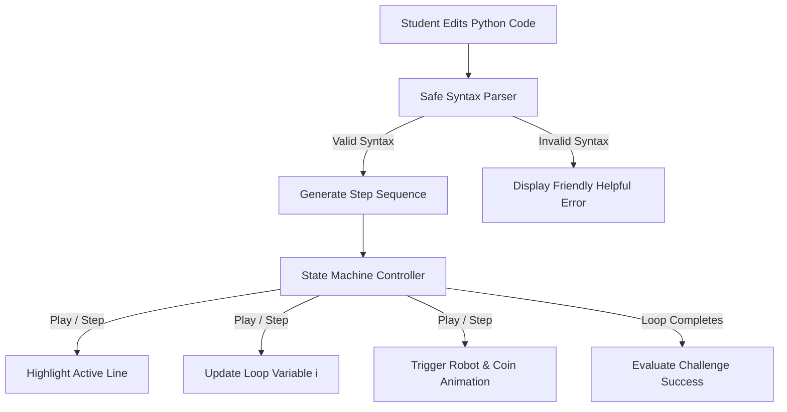

# 🤖 ByteBot: Interactive Python Loop Odyssey

> **Taming the abstract beast of programming loops with playful visual storytelling.**  
> Designed for first-year B.Tech students and absolute coding beginners.

---

## 💡 The Problem: Why Does Learning Loops Feel Like Decoding Hieroglyphics?

For millions of first-year engineering students and beginners, the introduction to programming usually starts like this:
```python
for i in range(5):
    print(i)
```
...outputting numbers `0, 1, 2, 3, 4` in a bleak black-and-white terminal. 

### Where Beginners Get Stuck:
1. **The "Off-By-One" Mystery**: Why does `range(5)` stop at `4`? Where did the `5` go?
2. **Invisible Time & State**: Code runs in milliseconds. Beginners can't see the loop variable `i` taking turns or holding state.
3. **No Emotional Payoff**: Printing raw numbers to a console fails to build intuition or excitement.

---

## 🚀 The Solution: ByteBot's Coin Quest

**ByteBot** turns the abstract mechanics of Python `for` loops into a physical, deterministic story:
* Every loop iteration is a **step forward**.
* Every execution of the loop body **collects a shiny gold coin**.
* Changing `range(5)` to `range(3)` physically changes the number of coins collected.
* Students can **Pause**, **Step through line-by-line**, and inspect live variable values as they change.

---

## ✨ Core Features

| **🔬 Python Tutor Visualizer** | Interactive execution trace showing call stack frames, variables, heap objects/pointers, and current (green ▶) / next (red ▷) line arrows with timeline scrubber and navigation (First/Prev/Next/Last/Auto). |
| **🤖 ByteBot AI Mentor** | Beginner tutor with **Explain Code**, **Progressive Hints (1-3)**, **Find My Mistake**, **Ask AI**, and **Predict & Test** quiz (Socratic, never replaces code). |
| **🛡️ Modular AI Adapters** | Plug-and-play adapter for **Google AI Studio (Gemini)** and **OpenRouter**, with safe zero-key offline tutor fallback. |
| **⚡ Server Safeguards** | Sliding-window IP rate limiting (15 req/min), timeouts, prompt sanitization, input size validation, and minimal token usage. |
| **🎮 Stepper & Playback** | Full control: **Play**, **Pause**, **Step Forward**, and **Reset** to inspect code at your own pace. |
| **🤖 Custom SVG Robot** | Fluid SVG animations with arm-waves, antenna glow, and coin grab animations—no generic emojis or heavy external assets. |
| **🎯 Interactive Challenges** | Built-in mission system (e.g. *"Edit the code to collect exactly 3 coins"*) with instant feedback. |
| **🔍 Live Execution Inspector** | Highlights the active code line, displays current `i` value badge, and provides simple, plain-English explanations for each cycle. |
| **🛡️ Safe Sandbox Interpreter** | Deterministic browser-side parser that validates syntax safely without dangerous `eval()` or unsanitized code execution. |
| **💎 Dark Glassmorphic UI** | Responsive, modern design with starry backdrops, glowing borders, and accessible typography. |

---

## 🛠️ Tech Stack

- **Framework**: [React 19](https://react.dev/) + [TypeScript](https://www.typescriptlang.org/)
- **Build Tool**: [Vite 6+](https://vitejs.dev/) (lightning-fast HMR)
- **Styling**: Handcrafted Vanilla CSS with CSS variables, keyframe animations, and Glassmorphism (no bulky UI frameworks)
- **Architecture**: 100% Client-side, zero paid APIs, zero backend requirements, zero login friction

---

## 📂 Project Structure

```text
AI_Coding_Agent/
├── public/
│   ├── favicon.svg          # Custom robot favicon
│   └── icons.svg            # UI icons
├── src/
│   ├── App.tsx              # Main interactive engine, code parser, and state machine
│   ├── App.css              # Glassmorphic layout, robot animation keyframes, coin styles
│   ├── index.css            # Base typography, CSS resets, and root color tokens
│   └── main.tsx             # React DOM entry point
├── package.json             # Scripts & dependencies
├── tsconfig.json            # Strict TypeScript configuration
└── vite.config.ts           # Vite bundling configuration
```

---

## 🚦 Getting Started

### Prerequisites
Make sure you have **Node.js** (v18 or newer) installed on your system.

### 1. Clone the repository
```bash
git clone https://github.com/prasannadupakuntla/AI_Coding_Agent.git
cd AI_Coding_Agent
```

### 2. Install dependencies
```bash
npm install
```

### 3. Start the development server
```bash
npm run dev
```
Open your browser and navigate to `http://localhost:5173` (or the port shown in your terminal).

### 4. Run test suites
```bash
npm test
```
Executes native unit tests for the deterministic parser, rate limiter, prompt builders, and AI adapters.

### 5. Build for production
```bash
npm run build
```
The compiled, optimized production assets will be generated in the `dist/` directory.

### 🔑 (Optional) AI Mentor Configuration
By default, the AI Mentor operates in **Offline Mode** with instant, zero-cost pedagogical guidance. To enable live models:
- Set environment variables: `GEMINI_API_KEY=your_key` or `OPENROUTER_API_KEY=your_key`
- Or enter your free key directly in the UI Settings drawer (stored only in browser session memory).

---

## 🧠 How the Execution Engine Works



1. **Parser & Validator**: Parses Python-like `for <var> in range(N):` syntax. Validates non-negative integer limits.
2. **Timeline Generator**: Translates code into discrete execution events (Loop Start &rarr; Line 1 &rarr; Line 2 &rarr; Coin Grab &rarr; Loop End).
3. **Reactive UI Sync**: Each step simultaneously updates the code editor highlighting, terminal output, robot posture, and coin counter.

---

## 🤝 Contributing & Future Roadmap

Contributions and feature suggestions are welcome! Here are a few ideas planned for future versions:
- [ ] Support for `range(start, stop, step)` parameters
- [ ] While loops with interactive condition toggles
- [ ] Nested loops with 2D grid navigation
- [ ] Sound effects and celebratory audio cues

---

## 📄 License

This project is licensed under the [MIT License](LICENSE).
